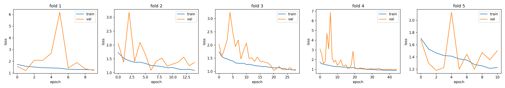
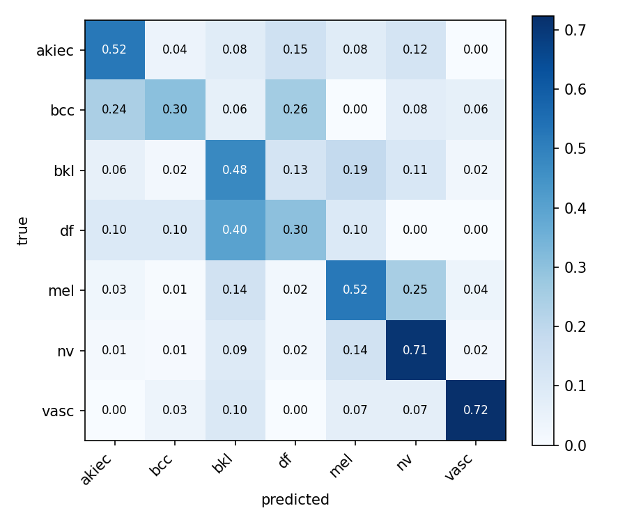
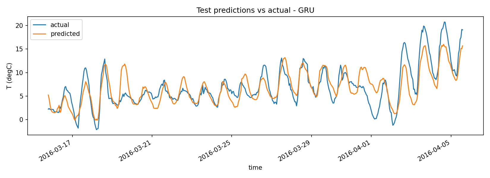

# Informe Técnico — TP Integrador Redes Neuronales (Keras CNN–RNN)

**Materia:** Inteligencia Artificial — Lic. en Sistemas de Información (FCyT–UADER)
**Integrantes:** [APELLIDO 1, Nombre] — [APELLIDO 2, Nombre]
**Fecha de entrega:** 30 de septiembre de 2026

---

## 1. Introducción

Se diseñaron, implementaron y evaluaron con Keras dos arquitecturas que explotan la estructura de los datos:

- **Espacio — CNN:** clasificación de lesiones cutáneas en 7 clases (`akiec`, `bcc`, `bkl`, `df`, `mel`, `nv`, `vasc`) sobre **HAM10000** (10 015 dermatoscopías, 96×96×3, normalizadas a [0, 1]). El dataset es muy desbalanceado (`nv` ≈ 67 %, `df` ≈ 1 %) y contiene varias imágenes de una misma lesión (`lesion_id`).
- **Tiempo — RNN:** pronóstico multivariado de la temperatura `T (degC)` a **+24 h** a partir de una ventana de **72 h** sobre **Jena Climate 2009–2016** (registros cada 10 min submuestreados a 1 h). Se usan 19 variables: 11 meteorológicas, el viento convertido a vector (`wx`, `wy`, `max wx`, `max wy`) y codificación cíclica seno/coseno de la hora del día y del día del año.

## 2. Módulo CNN

### 2.1 Arquitectura

| Etapa | Operación | Salida | Parámetros |
|---|---|---|---|
| Aumentación (solo train) | RandomFlip(h+v), RandomRotation(0.1), RandomZoom(0.1) | 96×96×3 | 0 |
| Bloque 1 | 2 × [Conv2D 32, 3×3, s=1, `same` → BN → ReLU] → MaxPool 2×2, s=2 | 48×48×32 | 10 400 |
| Bloque 2 | 2 × [Conv2D 64 → BN → ReLU] → MaxPool | 24×24×64 | 55 936 |
| Bloque 3 | 2 × [Conv2D 128 → BN → ReLU] → MaxPool | 12×12×128 | 222 464 |
| Cabeza | GlobalAveragePooling2D → Dropout(0.5) → Dense(7, softmax) | 7 | 903 |
| **Total** | | | **289 703** (288 807 entrenables) |

**Convolución, padding y stride.** La salida de cada capa es `o = ⌊(i + 2p − k)/s⌋ + 1`. Con `k=3`, `s=1` y `padding="same"` (`p=1`) se preserva la resolución (`o = i`), de modo que los bordes de la lesión se procesan igual que el centro; el pooling `k=2, s=2` la reduce a la mitad: 96 → 48 → 24 → 12. Cada Conv2D tiene `k·k·C_in·C_out + C_out` parámetros (p. ej. 3·3·64·128+128 = 73 856): gracias a la **conectividad local y los pesos compartidos**, el mismo detector de bordes/texturas recorre toda la imagen. Una capa densa conectando la entrada 96·96·3 a sólo 128 neuronas ya requeriría 3,5 M de parámetros, 12 veces más que toda la red.

**Campo receptivo.** Con `r_l = r_{l−1} + (k−1)·j_{l−1}` y `j_l = j_{l−1}·s`, el campo receptivo crece 3 → 5 → 6 → 10 → 14 → 16 → 24 → 32 → **36 px**: cada activación final "ve" un 37 % del lado de la imagen, suficiente para capturar la forma y el borde de la lesión; el Global Average Pooling integra luego toda la superficie.

**Pooling y equivarianza.** La convolución es equivariante a traslaciones (desplazar la entrada desplaza el mapa de características); MaxPool aporta invarianza local parcial, ya que un corrimiento menor que la ventana no modifica el máximo, y reduce la resolución y el costo de las capas siguientes. Usar **GAP en lugar de Flatten** reduce la cabeza de 12·12·128·7 = 129 024 a 903 parámetros y elimina la dependencia de la posición absoluta.

**Activaciones y estabilidad del gradiente.** En las capas ocultas se usa **ReLU** (derivada 1 en la zona activa: no satura ni atenúa el gradiente al propagarlo por 6 capas) con **inicialización He** (`Var(W) = 2/n_in`), que conserva la varianza de las activaciones bajo ReLU. **BatchNormalization** normaliza la preactivación de cada canal, estabiliza su distribución entre pasos y permite tasas de aprendizaje mayores. En la salida, **softmax** convierte los logits en una distribución de probabilidad sobre las 7 clases; junto con la **entropía cruzada categórica** equivale a maximizar la log-verosimilitud y produce el gradiente simple `ŷ − y`.

**Regularización.** Dropout 0.5 antes de la capa de salida, L2 (λ = 1e-4) en los núcleos convolucionales, aumentación geométrica (las dermatoscopías no tienen orientación canónica) y EarlyStopping.

### 2.2 Hiperparámetros

| Hiperparámetro | Valor | Justificación |
|---|---|---|
| Optimizador / LR inicial | Adam, 5e-4 | Reducido desde 1e-3 (primera iteración) para amortiguar la oscilación de la validación junto con BN |
| Scheduler | ReduceLROnPlateau (×0.5, paciencia 5, mín. 1e-6) | Afina el mínimo cuando la validación se estanca |
| Batch size | 32 | Compromiso entre memoria y ruido estocástico útil para BN |
| Épocas | máx. 60; EarlyStopping (paciencia 10, restaura mejores pesos) | Épocas ejecutadas: 60/35/34/25/34; mejor época media: 28.8 |
| Filtros | (32, 64, 128) | Se duplican al reducir la resolución a la mitad (costo por bloque ≈ constante) |
| Desbalance | `class_weight="balanced"` calculado **solo con el train de cada fold** | Pesos de 0.21 (`nv`) a ≈ 12 (`df`); usar todo el dataset filtraría la distribución de validación |

### 2.3 Partición sin fuga de información

Una partición aleatoria pondría imágenes de la misma lesión en train y validación, y la red podría "reconocer la lesión" (color de piel, vello, reglas o marcas del dermatoscopio) en lugar de aprender la clase. Por eso: (1) `GroupShuffleSplit` separa un **holdout de test del 15 %** por `lesion_id` (8 488 imágenes de desarrollo / 1 527 de test); (2) sobre desarrollo se aplica **`StratifiedGroupKFold` (k = 5)**, que mantiene cada lesión en un solo fold y preserva la proporción de clases; (3) un `assert` verifica en ejecución que los grupos de train y validación sean disjuntos. El test sólo se usa una vez, con el modelo del fold de menor `val_loss` (fold 3).

### 2.4 Resultados

Por el desbalance, *accuracy* no es informativa (predecir siempre `nv` da 67 %): se reportan **balanced accuracy** (media de los *recalls*), **F1 macro**, **ROC-AUC one-vs-rest** y el **recall de melanoma**, la clase clínicamente crítica.

| Partición | Balanced acc. | F1 macro | ROC-AUC (OvR) | Recall `mel` |
|---|---|---|---|---|
| Fold 1 | 0.601 | 0.466 | 0.898 | 0.554 |
| Fold 2 | 0.449 | 0.385 | 0.871 | 0.414 |
| Fold 3 | 0.558 | 0.479 | 0.887 | 0.753 |
| Fold 4 | 0.410 | 0.346 | 0.885 | 0.594 |
| Fold 5 | 0.468 | 0.400 | 0.856 | 0.442 |
| **CV: media ± σ** | **0.497 ± 0.071** | **0.415 ± 0.050** | **0.880 ± 0.015** | **0.551 ± 0.121** |
| **Test holdout** | **0.527** | **0.451** | **0.898** | **0.618** |

*Figura 1. Pérdida de entrenamiento y validación por fold.*

*Figura 2. Matriz de confusión normalizada por fila en el test holdout.*

### 2.5 Análisis de sesgo y varianza

- **Generalización y ausencia de fuga.** La métrica de test (0.527) cae dentro del intervalo de CV (0.497 ± 0.071) y el AUC coincide (0.898 vs 0.880). Si la red memorizara artefactos visuales de lesiones repetidas, el rendimiento sobre lesiones nunca vistas sería claramente inferior al de CV; no ocurre.
- **Sesgo (underfitting) dominante.** En la mejor época, la *accuracy* de train (0.52–0.62) es similar a la de validación (0.56–0.63) y la pérdida de train sigue bajando lentamente (≈ 1.0 al final). La red no llega a ajustar bien ni siquiera el entrenamiento: el error es principalmente de sesgo, atribuible a la baja resolución (96×96 pierde detalle de textura) y a la capacidad moderada (≈ 290 k parámetros). La pérdida de train aparece a veces por encima de la de validación porque se calcula con aumentación, dropout, penalización L2 y pesos de clase, que la inflan; la de validación no los incluye.
- **Varianza baja en el modelo, alta en las clases minoritarias.** No hay brecha creciente train–val (sin overfitting sostenido): EarlyStopping corta 10 épocas después del mínimo y restaura esos pesos. La validación es ruidosa, con picos en las primeras épocas (fold 4: 3.7) por la actualización de las estadísticas de BN con LR alto y por la escasez de muestras minoritarias (≈ 20–30 imágenes de `df` o `vasc` por fold). Esa escasez explica la varianza entre folds: σ del recall `bcc` = 0.23 (0.00 en el fold 4, 0.67 en el 5) frente a σ = 0.03 en `bkl`. El AUC, que mide la capacidad de ordenar y no depende del umbral de `argmax`, es estable (σ = 0.015): la representación aprendida es consistente y lo que varía es la frontera de decisión en las clases raras.
- **Errores sistemáticos.** La Figura 2 muestra confusiones clínicamente plausibles entre clases pigmentadas: `mel`→`bkl` (24 %), `df`→`bkl` (40 %) y `nv`→`mel` (15 %). Por los pesos de clase, el recall de `nv` baja a 0.65 a cambio de detectar el 62 % de los melanomas, un intercambio deseable en un contexto de cribado.

## 3. Módulo RNN

### 3.1 Elección de la celda y BPTT

En una RNN simple, `h_t = tanh(W_h h_{t−1} + W_x x_t + b)`, y el gradiente propagado por BPTT a lo largo de `T` pasos es un producto de jacobianos:

`∂h_T/∂h_k = ∏_{t=k+1}^{T} diag(tanh'(a_t)) · W_h`

Si el radio espectral de `W_h` (por `|tanh'| ≤ 1`) es < 1, la norma decae exponencialmente (**desvanecimiento**) y la red no aprende dependencias de 24–72 h; si es > 1, crece exponencialmente (**explosión**). Con ventanas de 72 pasos, la RNN simple no es viable.

- **LSTM** actualiza la celda de forma **aditiva**: `c_t = f_t ⊙ c_{t−1} + i_t ⊙ c̃_t`, por lo que `∂c_t/∂c_{t−1} = diag(f_t)`. Si la compuerta de olvido `f_t ≈ 1`, el gradiente atraviesa el tiempo casi sin atenuarse (*constant error carousel*), y la red aprende cuándo recordar y cuándo olvidar.
- **GRU** combina olvido y entrada en una compuerta de actualización: `h_t = (1 − z_t) ⊙ h_{t−1} + z_t ⊙ h̃_t`, con `∂h_t/∂h_{t−1} ≈ diag(1 − z_t)`: el mismo camino aditivo con 3 bloques de pesos en lugar de 4 (≈ 25 % menos parámetros).
- **Activaciones:** sigmoide en las compuertas (rango [0, 1], interpretable como la fracción de información que pasa); tanh en el candidato y el estado (rango [−1, 1], centrada en cero, acota el estado); ReLU en la capa densa intermedia y **salida lineal**, porque se trata de una regresión no acotada.
- **Explosión:** las compuertas atacan el desvanecimiento, pero no impiden la explosión; por eso se usa **gradient clipping** `clipnorm = 1.0`, que reescala `g ← g·1/‖g‖` cuando la norma supera 1, conservando la dirección.

Se entrenaron **LSTM y GRU** con la misma arquitectura y se eligió la de mejor rendimiento. Arquitectura: `Input(72×19) → Celda(64, return_sequences) → Celda(64) → Dense(32, ReLU) → Dense(1)`, con dropout de entrada 0.2 y dropout recurrente 0.15 (máscara fija en todos los pasos) y L2 = 1e-4 en los pesos de entrada y recurrentes.

### 3.2 Split cronológico y normalización

El split es **estrictamente cronológico, sin mezclar: 70 % train (ene 2009 – ago 2014) / 20 % validación (ago 2014 – mar 2016) / 10 % test (mar – dic 2016)**. La media y el desvío de normalización se ajustan **solo con train** y se guardan en `models/rnn_norm.json` para la inferencia. Las ventanas se generan dentro de cada partición, así que ninguna cruza una frontera: el target de cada ventana es `T` en la posición `72 + 24 − 1`, y se verifica la alineación de los *timestamps*. Solo se mezclan las ventanas del conjunto de train entre sí, lo que no filtra información del futuro porque cada ventana es un par (pasado → futuro) autocontenido.

### 3.3 Hiperparámetros

| Hiperparámetro | Valor | Justificación |
|---|---|---|
| Optimizador | Adam, LR 1e-4, `clipnorm=1.0` | LR bajo para una convergencia estable del BPTT a 72 pasos; el *clipping* evita la explosión |
| Pérdida / métrica | MSE / MAE | MSE penaliza más los errores grandes (picos de temperatura); MAE se interpreta en °C |
| Batch / épocas | 256 / máx. 50, EarlyStopping (paciencia 8) | Ventanas muy correlacionadas: un batch grande estabiliza el gradiente |
| Ventana / horizonte | 72 h / +24 h | Tres ciclos diarios completos de contexto |
| Unidades | (64, 64) + Dense 32 | Suficiente para 19 variables con ≈ 43–57 k parámetros |

### 3.4 Resultados en test

| Modelo | MAE (°C) | RMSE (°C) | Parámetros | Épocas | Tiempo |
|---|---|---|---|---|---|
| Persistencia (`T(t+24) = T(t)`) | 2.371 | 3.086 | 0 | — | — |
| Denso (Flatten → Dense 64 → 1) | 2.247 | 2.842 | 87 681 | 32 | 107 s |
| LSTM (64, 64) | 2.110 | 2.664 | 56 641 | 50 | 3 004 s |
| **GRU (64, 64)** | **2.062** | **2.611** | **43 393** | 50 | 2 755 s |

La **GRU** es el mejor modelo: reduce el MAE un **13.0 %** respecto de la persistencia y un **8.2 %** respecto del denso, con la mitad de parámetros que este último. La mejora frente al denso, que ve la misma ventana pero aplanada y sin noción de orden, confirma que la recurrencia aprovecha la estructura secuencial.

*Figura 3. Predicción a +24 h de la GRU frente al valor real (tramo de test).*

### 3.5 Estabilidad predictiva y ajuste

- **Curvas de aprendizaje.** El **denso sobreajusta**: MSE de train 0.088 contra 0.145 de validación (normalizado), con una brecha que crece hasta la detención en la época 32. **LSTM y GRU no muestran brecha** (0.137/0.138 y 0.143/0.133), pero su mejor época fue la 48 y la 50 de 50: todavía mejoraban al alcanzar el límite. El diagnóstico es un **leve underfitting por presupuesto de épocas** (LR 1e-4) y no por capacidad; aumentar las épocas es la mejora inmediata. La regularización recurrente cumplió su función: no hay varianza excesiva.
- **Residuos.** Son aproximadamente normales, con media −0.19 °C y σ = 2.60 °C: un sesgo sistemático despreciable (ligera sobreestimación).
- **Estabilidad temporal.** El MAE mensual de la GRU oscila entre 1.5 °C (marzo) y 2.5 °C (julio y diciembre), sin deriva a lo largo de los 10 meses de test: el modelo no se degrada al alejarse del período de entrenamiento. El error aumenta en los meses de mayor variabilidad sinóptica. En la Figura 3 la predicción sigue el ciclo diario, pero suaviza los extremos y reacciona con retraso a los cambios bruscos de régimen (frentes, p. ej. 2–5 de abril), información que no está contenida en la ventana pasada de una sola estación.

## 4. Conclusiones

1. **La partición determina la validez de las métricas.** Con la agrupación por `lesion_id` y el time split cronológico, test y validación coinciden (CNN: 0.527 vs 0.497 ± 0.071; RNN: sin deriva mensual), lo que confirma una evaluación honesta, sin fuga de información.
2. **CNN:** el diseño convolucional con padding `same`, pooling y GAP generaliza (AUC 0.90) con solo 290 k parámetros. Su límite es el **sesgo**, no el sobreajuste; la varianza se concentra en las clases con pocas lesiones. Mejoras posibles: mayor resolución de entrada, más profundidad o *transfer learning* y *focal loss* para las clases minoritarias.
3. **RNN:** las celdas con compuertas, más el *gradient clipping*, entrenan de forma estable sobre 72 pasos y superan a ambos baselines; la GRU logra el menor error con menos parámetros. Mejoras posibles: más épocas, horizonte multi-paso y variables exógenas (pronósticos regionales) para anticipar cambios de régimen.

**Entregables:** código en `cnn/`, `rnn/` y `predict.py`; modelos exportados en `models/` (`cnn_ham10000.keras`, `rnn_jena_gru.keras`, `rnn_jena_lstm.keras`, `cnn_classes.json`, `rnn_norm.json`); métricas y figuras en `reports/`.
